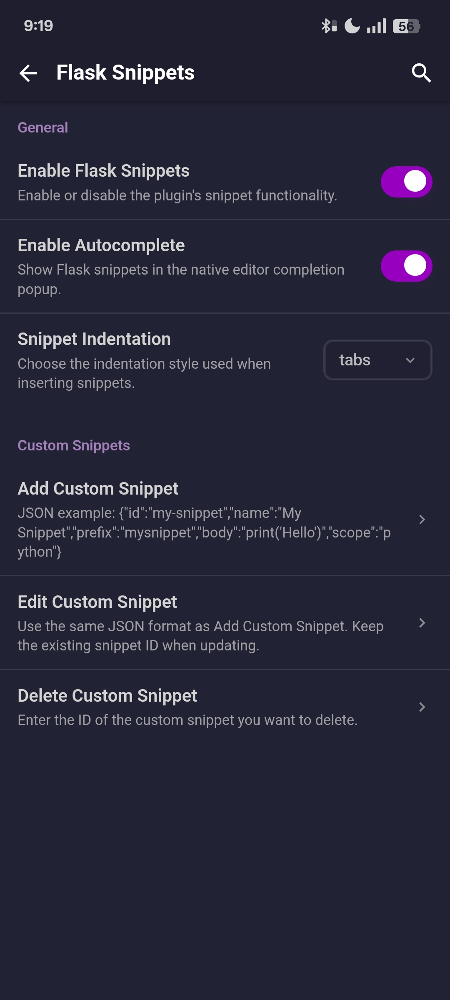
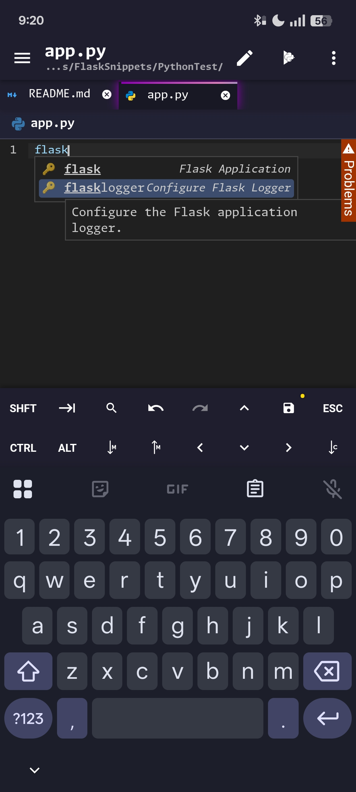
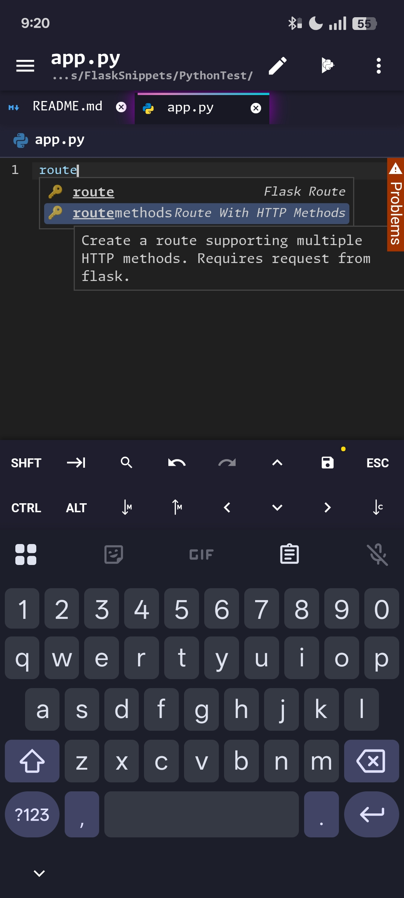
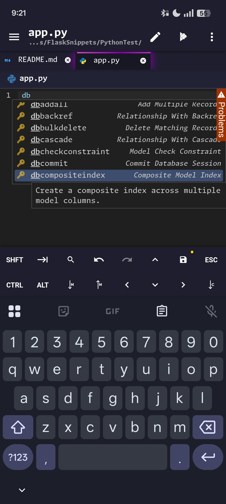
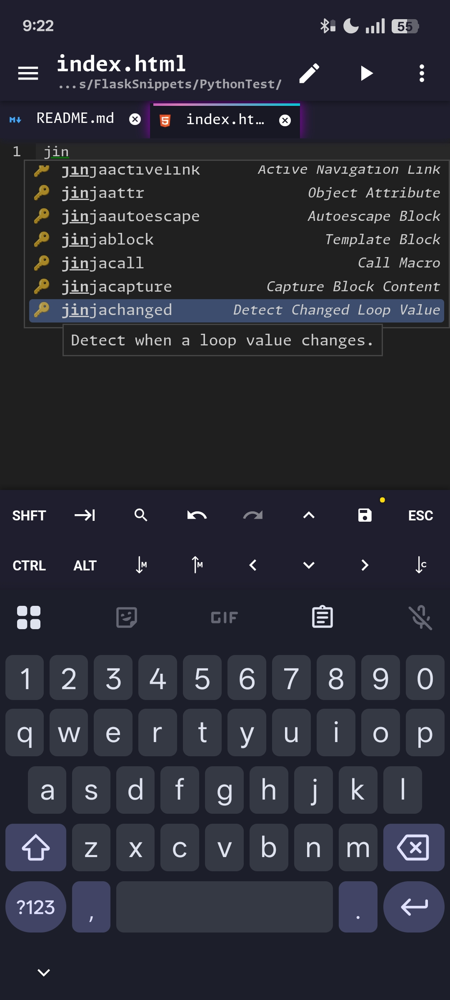

# Flask Snippets

A comprehensive Flask and Python snippet collection for Acode. Write Flask applications faster with ready-to-use code snippets directly through Acode's native autocomplete experience.

## Features

- **342 built-in snippets** covering Flask development.
- **Native Acode autocomplete integration** — insert snippets directly from the editor.
- **Six snippet categories** covering Flask fundamentals, architecture, extensions, databases, authentication, and Jinja.
- **Custom snippets** — add, edit, and delete your own snippets through plugin settings.
- **Configurable indentation** — choose between 2 spaces, 4 spaces, 8 spaces, or tabs.
- **Python and Jinja support** — snippets are available in supported Python and template files.
- **Lightweight workflow** — no separate snippet browser or custom editor interface.

## Snippet Categories

Flask Snippets includes 342 built-in snippets organized into six categories.

| Category | Number of Snippets |
|---|---:|
| Flask Core | 37 |
| Architecture | 42 |
| Extensions | 67 |
| Database | 63 |
| Authentication | 33 |
| Jinja | 100 |
| **Total** | **342** |

### Flask Core

Common Flask functionality, including application setup, routes, request handling, responses, configuration, and error handling.

### Architecture

Reusable application structures and patterns for organizing Flask projects and building maintainable applications.

### Extensions

Snippets for working with Flask extensions and integrating additional functionality into Flask applications.

### Database

Database-related snippets for models, queries, relationships, and database operations.

### Authentication

Authentication-related snippets for user management, login workflows, sessions, and access control.

### Jinja

Jinja template snippets for template inheritance, variables, filters, conditions, loops, macros, and other template functionality.

## Supported File Types

### Python

- `.py`
- `.pyw`

### Jinja / HTML Templates

- `.html`
- `.htm`
- `.xhtml`
- `.jinja`
- `.jinja2`
- `.j2`

## Requirements

- Acode
- Python for running Python applications
- Flask and any other dependencies required by the code snippets you use

**Important:** Flask Snippets provides code snippets only. It does not install Python, Flask, or third-party dependencies for you.

## Installation

### Install through Acode

1. Open Acode.
2. Navigate to the Plugin Manager.
3. Find Flask Snippets if it is available in the plugin listing.
4. Install and enable the plugin.

### Install from GitHub

1. Visit the repository:

   https://github.com/Ryze282747/FlaskSnippets

2. Download the repository or its available release ZIP.
3. Install the plugin ZIP through Acode's plugin installation options.
4. Enable Flask Snippets.

## Getting Started

1. Open a supported Python or Jinja file.
2. Make sure Flask Snippets is enabled.
3. Start typing a snippet prefix.
4. Select the suggested snippet from Acode's native autocomplete suggestions.
5. Insert the snippet and customize the generated code.

Snippet availability depends on the active file type and the plugin settings.

## Plugin Settings

Flask Snippets provides settings for controlling its behavior.

### Enable Plugin

Controls whether the plugin is active.

### Enable Autocomplete

Controls whether snippet suggestions are provided through Acode's native autocomplete experience.

### Indentation

Choose the indentation style used when inserting snippets.

Available options:

- 2 Spaces
- 4 Spaces
- 8 Spaces
- Tabs

The default indentation is 4 spaces.

### Custom Snippets

You can manage your own snippets through the plugin's Settings page.

Available operations:

- Add a custom snippet.
- Edit an existing custom snippet.
- Delete a custom snippet.

Custom snippets are integrated into the same snippet suggestion workflow.

## Custom Snippets

You can create your own snippets to add code that is not included in the built-in collection.

### Example

The following is an example of a custom Python snippet:

```json
{
  "id": "custom:hello-world",
  "name": "Hello World",
  "prefix": "hello",
  "category": "custom",
  "description": "Print a hello world message.",
  "body": [
    "print('Hello, World!')"
  ],
  "tags": [
    "custom",
    "print",
    "hello"
  ],
  "scope": [
    "python"
  ]
}
```

### Custom Snippet Fields

| Field | Description |
|---|---|
| `id` | Unique identifier for the snippet. |
| `name` | Display name of the snippet. |
| `prefix` | Text used to trigger the snippet suggestion. |
| `category` | Snippet category. Custom snippets use `custom`. |
| `description` | Short explanation of the snippet. |
| `body` | Code inserted when the snippet is selected. |
| `tags` | Keywords associated with the snippet. |
| `scope` | File language or scope where the snippet is available. |

### Custom Snippet Notes

- Each snippet must have a unique ID.
- Each snippet must have a unique prefix.
- The `body` can contain multiple lines.
- Custom snippets are managed through plugin settings.
- Custom snippets are assigned to the `custom` category.

## Screenshots

Screenshots will be added to the repository's `screenshots/` directory.

### Plugin Settings



### Python Snippets



### Flask Route Snippets



### Database Snippets



### Jinja Snippets



### Snippets are not appearing

- Make sure Flask Snippets is installed and enabled.
- Check whether autocomplete is enabled in plugin settings.
- Confirm that the active file uses a supported extension.
- Check that the prefix is typed correctly.
- Restart or reopen the editor file if suggestions do not appear.

### Custom snippet is not appearing

- Check the snippet's prefix.
- Verify that its scope matches the active file type.
- Make sure its ID and prefix are unique.
- Check that the custom snippet was saved successfully.

### Indentation does not look correct

- Open Flask Snippets settings.
- Select your preferred indentation option.
- Insert the snippet again.

## Project Information

| Property | Value |
|---|---|
| Plugin Name | Flask Snippets |
| Plugin ID | `dev.zylle.flasksnippets` |
| Author | Zylle |
| Version | 1.0.0 |
| License | MIT |
| Platform | Acode |
| Repository | [Ryze282747/FlaskSnippets](https://github.com/Ryze282747/FlaskSnippets) |

## Author

**Zylle**

- GitHub: [Ryze282747](https://github.com/Ryze282747)
- Instagram: [ryzexlsv](https://www.instagram.com/ryzexlsv)
- Acode Profile: [Zylle Mojica](https://acode.app/profile/31227)

## Other Plugins

Check out my other Acode projects:

[Acode Profile](https://acode.app/profile/31227)

## Contributing

Suggestions, bug reports, and contributions are welcome.

If you find a problem or have an idea that could improve Flask Snippets, you can open an issue or submit a contribution through the GitHub repository.

## License

Flask Snippets is licensed under the MIT License.

See the [LICENSE](https://github.com/Ryze282747/FlaskSnippets/blob/main/LICENSE) file for details.